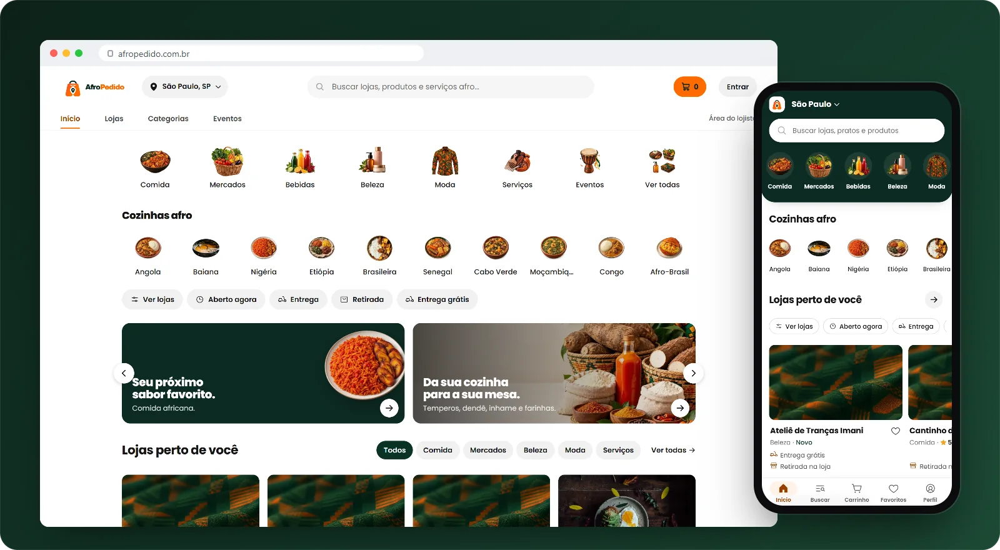

  

Desenvolvo produtos web e mobile e acompanho o trabalho da definição do projeto até a publicação.

[Portfólio](https://armandomateus.com) · [Dynner Sight Solutions](https://dynnersight.com.br) · [LinkedIn](https://www.linkedin.com/in/armandocapita/)

## Produtos no ar

### AfroPedido · [afropedido.com.br](https://afropedido.com.br/)

Marketplace web e Android para encontrar negócios da comunidade africana e afrodescendente no Brasil. Desenvolvi o fluxo em que o cliente monta o pedido e acompanha o andamento, e o painel em que o lojista gerencia os produtos e atualiza cada pedido. Cada pedido reúne itens de uma única loja: assim ele tem um só responsável pelo atendimento, e o andamento que o cliente acompanha é o daquela loja.

### Ondela · [ondela.com.br](https://ondela.com.br/) · [Google Play](https://play.google.com/store/apps/details?id=app.ondela.mobile)

Rede social brasileira na web e no Android, com conversas, vídeos curtos e Flashes. Desenvolvi as versões web e Android do produto. Quem publica um Flash escolhe, no momento da publicação, se ele fica visível para todos ou apenas para o círculo “Entre nós”.

## Código público

- **[bank-simulator-api](https://github.com/Armandomateus41/bank-simulator-api)** · TypeScript, Prisma e PostgreSQL. API de simulação bancária com testes nas regras de saldo: veja o [teste que impede saque sem saldo](https://github.com/Armandomateus41/bank-simulator-api/blob/cb78b81f9e6247a9c5a65f5383223123347067aa/src/__tests__/transaction.service.test.ts#L37-L41) e o [workflow que aplica as migrações e executa os testes](https://github.com/Armandomateus41/bank-simulator-api/blob/cb78b81f9e6247a9c5a65f5383223123347067aa/.github/workflows/ci-cd-github-actions.yaml#L45-L49) num PostgreSQL de serviço.
- **[onfly-booking-system](https://github.com/Armandomateus41/onfly-booking-system)** · Laravel. API REST de pedidos de viagem corporativa com autenticação JWT: veja o [teste da regra que impede o solicitante de alterar o status do próprio pedido](https://github.com/Armandomateus41/onfly-booking-system/blob/1bcd095f65de2473d577a5eed4abe3bef358c648/tests/Feature/TravelRequestTest.php#L83-L96).

## Stack

React · Next.js · TypeScript · Node.js · NestJS · PostgreSQL · Docker
